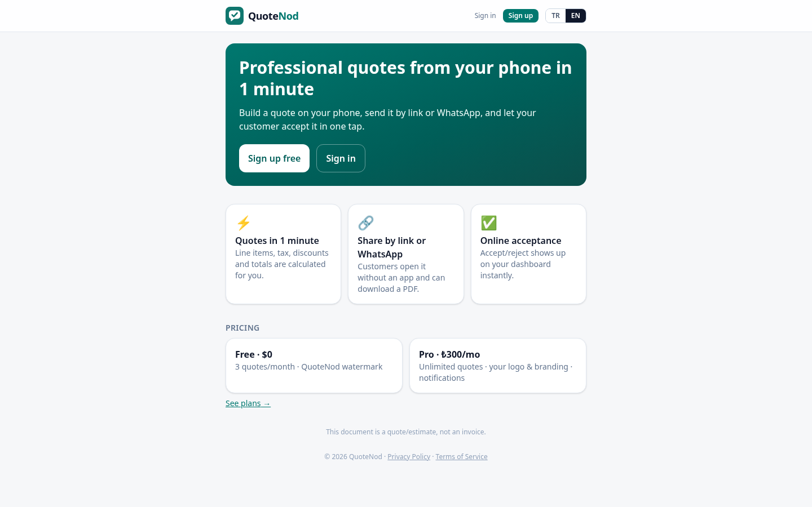

# QuoteNod

**Mobile-first quote & estimate generator for tradespeople and freelancers**

> **Source code is private — this repository is a showcase.** It contains only this README and screenshots; no source code, credentials or customer data.

🔗 **Live:** [quotenod.com](https://quotenod.com)

## What it is
QuoteNod lets tradespeople and freelancers build a professional quote on their phone in about a minute, send it by link or WhatsApp, and let the customer accept or reject it online in one tap. It deliberately handles **quotes/estimates only — never invoices**. English by default, Turkish auto-detected.

## Key features
- Single-screen quote editor: line items, quantities, units, per-line tax, discounts (% or fixed) with live totals
- Multi-currency with locale-aware formatting; tax grouped by rate (VAT, GST, sales tax)
- Server-side PDF generation with business logo
- Unguessable public share link — customer views, accepts or rejects with an optional note
- WhatsApp share and copy-link
- Dashboard with statuses: draft, sent, viewed, accepted, rejected, expired
- Free and Pro plans (watermark, quote limits, branding)
- EN/TR UI with browser auto-detection and toggle

## Tech stack
- Next.js 15 (App Router) · React 19 · TypeScript
- Tailwind CSS v4
- Supabase (Postgres, Auth, Storage)
- @react-pdf/renderer
- Vitest · Playwright · PGlite (SQL/RLS tests)
- Vercel

## Architecture overview
```
Browser (mobile-first Next.js UI)
   │
   ├── Server routes ── PDF rendering, quote CRUD
   │        │
   │        └── Supabase Postgres (Row Level Security: owners see only their own rows)
   │
Customer (public link) ── token-scoped RPCs only (view / accept / reject)
```
- Anonymous visitors have no direct table access; public actions go through narrow, token-scoped database functions.
- Totals math, validation and PDF output are unit-tested; database policies are tested against an in-memory Postgres.

## Screenshots

*Landing page (quotenod.com)*

## Contact
**Göksel Eren Nurcan** — full-stack & mobile developer
🌐 [gokselerennurcan.dev](https://gokselerennurcan.dev) · ✉️ gerennurcan02@gmail.com · GitHub [@KhaiRonin](https://github.com/KhaiRonin)

Happy to give a walkthrough or a live demo on request.
